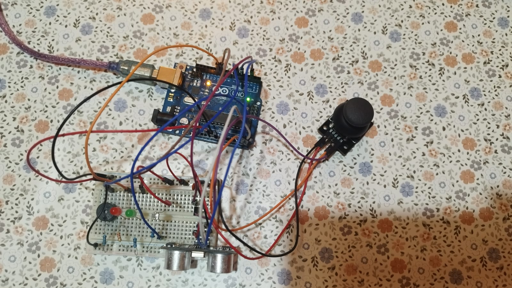
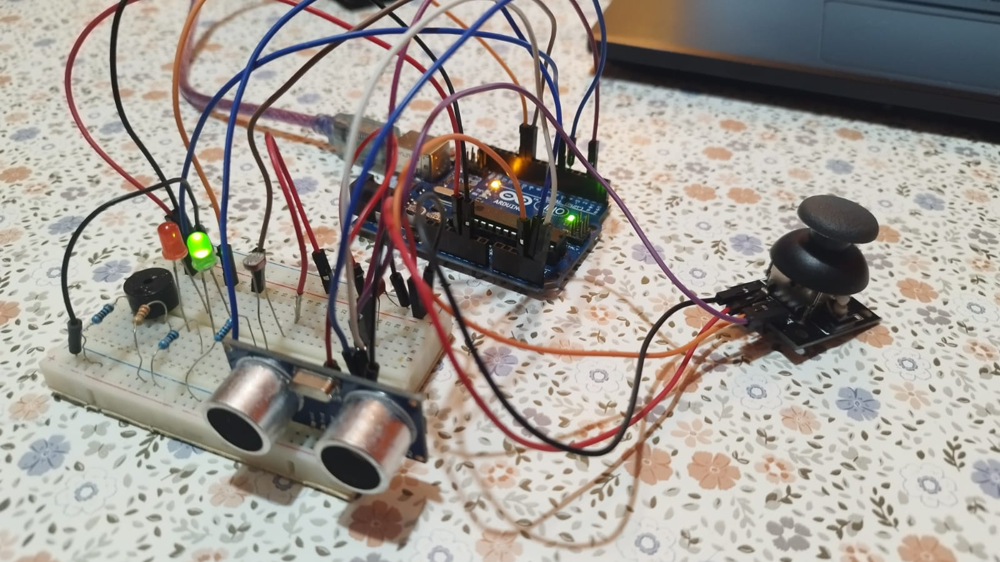
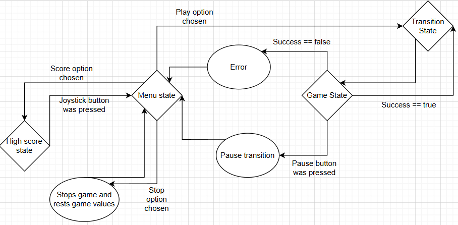
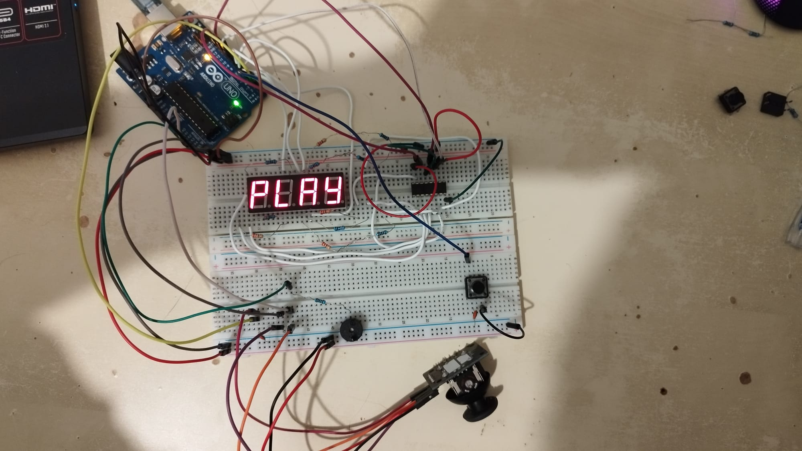
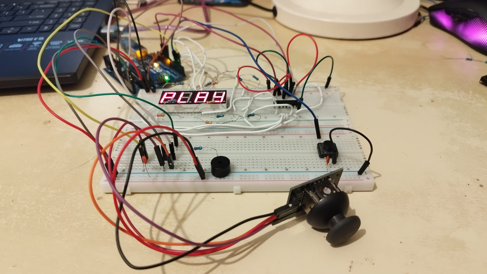
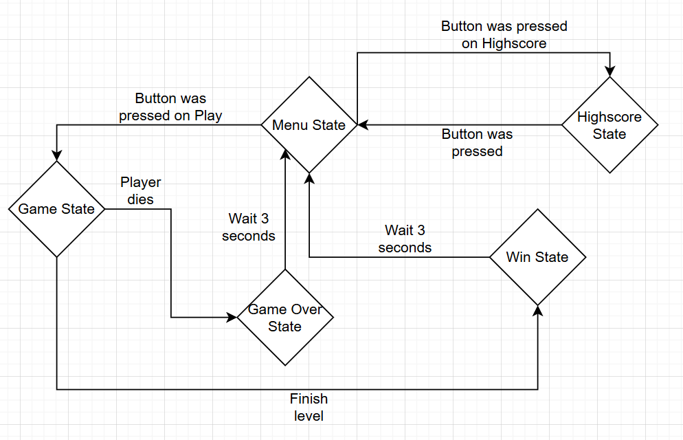
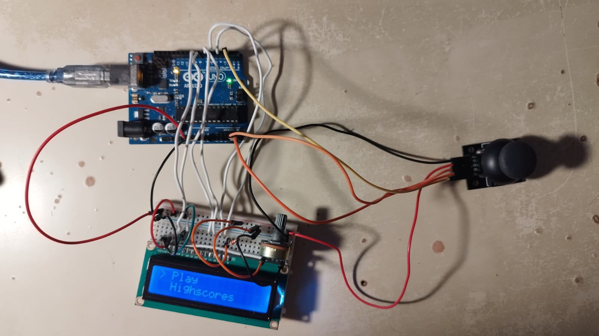
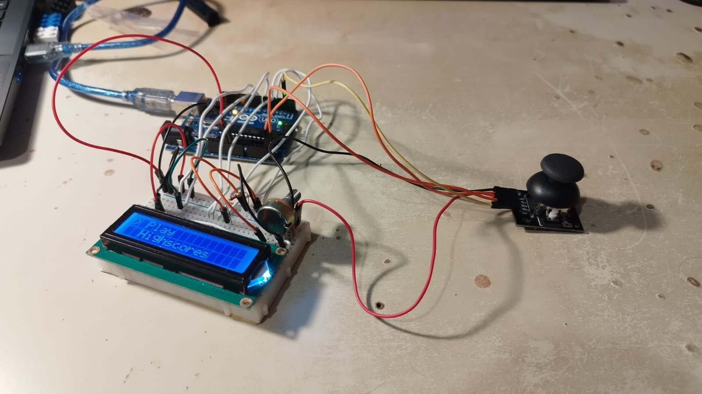

# IntroductionToRobotics
A repository for my Robotics course homeworks

## Homework #1 : RGB LED

### 1. Task:

I used 3 potentiometers to command and RGB LED with an arduino uno as intermidiary, each potentiometer for one of the 3 colours.

### 2. Implementation:

In order to use the the RGB LED(which has a common anode) i had to calculate what resistances to use for each of the LEDs in order to have the same current passing in them all(calculations are shown further down the page). I used 3 analog pins to read the values from the potentiometers and converted them to output values for 3 PWM digital pins. The PWM pins are conected to one resistor each and then to the cathodes of the LEDs. When a PWM pin provides the value 255 (5V) the difference in electric potential energy between the anode and the cathode is 0 so there is no current through the LED. When the value is 0 (0V) then the voltage on the LED is enough to make it turn on (is roughly 2.8V for green and blue and 1.8V for red).

#### Schematics and calculations:

#### Setup:

#### [Video of project implementation](https://www.youtube.com/watch?v=72QZH-2uAGI)

## Homework #2 : Traffic lights system

### 1. Task:

Create a traffic lights system that has 2 traffic lights (3 LEDs for vehicles and 2 LEDs for pedestrians), a 7 segment display (show how many seconds are left until next system state), a buzzer (beeps at different intervals depending on system state) and a button (pedestrians can press the button to make the vehicle light red and the pedestrian light green). The system has 4 states:

1. Red for Pedestrians, Green for vehicles. Awaits button press (can last indefinetely). Upon pressing an 8 second countdown starts and then switches to state 2.

2. Red for Pedestrians, Yellow for vehicles. Lasts 3 seconds then switches to state 3.

3. Green for Pedestrians, Red for vehicles and a buzzer makes a sound at regular intervals. Lasts 8 seconds then switches to state 4.

4. Green that blinks for Pedestrians, Red for vehicles and the buzzer makes a sound more frequently than in the previous state. Lasts 4 seconds then switches back to state 1.

### 2. Implementation:

Implementation was done gradually both in terms of hardware and software:

1. First was the 7 segment display. I looked in the datasheet and calculated what resisors to use (330 ohms) and afterwards i tested whether it was common anode or common cathode (it was common cathode). In terms of software i made a function that looks in a matrix of preset values and sends them to the segment pins in order to show digits.

2. The traffic lights consist of 5 LEDs: 2 green, 2 red and 1 yellow. I used five 220 ohm resistors for them and connected them to 5 analog pins which i used as digital ones. The next step in terms of software was to arrange the states and their sequences and associate durations to them (countdowns are shown on display).

3. I added a button on an interrupt pin (2) and set it up as INPUT_PULLUP so by default it would be on HIGH. I designed the system so the main loop only checks whether there is a countdown to show on the display and what state the system is in. There is a function for each of the 4 states and 2 others for the button functionality. The ISR (interrupt service routine) checks for the possibility of a button press and another confirms it by debouncing. After the confirmation the sequence of states begins. Each state sets up the parameters for the next state(ex: resests the last check of time for the countdown, the duration of the state etc.).

4. I added a buzzer which i connected to a PWM pin (5) and to a 110 ohm resistor. The final software changes i did were making the buzzer "buzz" once every second in state 3 and twice a second in state 4, and making the green pedestrian light blink twice a second in state 4.

#### Schematics and calculations:

#### Setup:

#### [Video of project implementation](https://youtu.be/X22UugSl8GE?si=Flerypy0by5hy_sm)

## Homework #3 : Home Alarm System

### 1. Task:

Create a home alarm system with multiple sensors, password protection, and a menu-based interface. The system should detect intruders using an ultrasonic sensor and automatically arm when light levels drop below a threshold using a photoresistor (LDR). The system includes a buzzer for alarms, status LEDs, and a joystick for menu navigation.

### 2. Implementation:

The system was built using object-oriented programming principles with a SecuritySystem class that manages all functionality:

#### 1. Hardware Components:
   - Ultrasonic sensor connected to pins 5 (trigger) and A5 (echo) for distance measurement and intruder detection
   - Photoresistor (LDR) connected to pin A4 with a 10k ohm pull-down resistor to detect ambient light levels
   - Buzzer connected to PWM pin 6 with a 100 ohm resistor for alarm sounds
   - Red LED on pin 11 (blinks when alarm is triggered) with a 220 ohm resistor
   - Green LED on pin 10 (indicates disarmed state) with a 220 ohm resistor
   - Joystick with Y-axis on pin A3 and button on interrupt pin 2 (with internal pull-up) for menu navigation

#### 2. Core Functionality:
   - System starts armed by default and loads settings from EEPROM on boot
   - Ultrasonic sensor continuously monitors distance; if an object gets closer than the threshold (default 15cm), the alarm is triggered
   - LDR sensor monitors light levels; when light drops below threshold (default 300), the system automatically arms after a 3-second delay
   - Password-protected disarming via serial input
   - Alarm triggers red LED blinking and buzzer pulsing when activated

#### 3. Menu System:
   - Interactive menu system navigated with joystick (up/down to move, press to select)
   - Two main menus: armed state (only "Disarm System") and disarmed state with multiple options
   - Disarmed menu includes: "Arm System", "Alarm test", and "Settings"
   - Settings submenu allows configuration of:
     - Ultrasonic sensitivity (distance threshold in cm)
     - LDR light threshold (0-1023)
     - Buzzer tone/frequency (1-10000 Hz)
     - System name (1-50 characters)
     - Password change (3-20 characters, requires old password)

#### 4. EEPROM Storage:
   - All settings are saved to EEPROM and persist across power cycles
   - Stored settings include: distance threshold, LDR threshold, buzzer tone, system name, and password
   - Uses a magic number system to detect if EEPROM has been initialized

#### 5. Alarm System:
   - When triggered, the red LED blinks at 250ms intervals
   - Buzzer pulses with customizable tone (300ms on, 100ms off)
   - Alarm can only be stopped by entering the correct password via serial interface
   - Test mode allows manual activation/deactivation of alarm for testing

#### 6. Software Architecture:
   - Menu class handles menu display and navigation
   - SecuritySystem class encapsulates all system logic and state management
   - Interrupt service routine for joystick button press detection
   - Serial input processing for password entry and settings configuration
   - Non-blocking timing using millis() for delays, LED blinking, and buzzer pulsing

#### Setup:

#### [Video of project implementation](https://youtu.be/LuozW9B1iD8?si=7r7UkfISAJgOqg5x)

## Homework #4 : Simon Says Game

### 1. Task:

Create a memory-based game implemented on Arduino with 4 seven-segment displays. Players must remember and recreate a sequence of characters shown on the displays. The game displays a random sequence that players must replicate. The difficulty increases as the score increases by reducing the display time.

### 2. Implementation:

#### Hardware Components:

1. Shift Register (74HC595): Controls 7-segment display segments via pins 10 (clock), 11 (latch), 12 (data)
2. 7-Segment Displays (4 digits): Common cathode, digit control pins on 4, 5, 6, 7
3. Joystick: X-axis on A4, Y-axis on A5, button on pin 2 (interrupt)
4. Pause Button: Pin 3 (interrupt)
5. Buzzer: Pin A3 for audio feedback

#### Pin Map:

| Pin | Component | Function |
|-----|-----------|----------|
| 2 | Joystick Button | Select/lock digit, submit answer |
| 3 | Pause Button | Return to menu |
| 4-7 | Display Digits | Control pins for 4 digits (D1-D4) |
| 10 | Shift Register | Clock pin |
| 11 | Shift Register | Latch pin |
| 12 | Shift Register | Data pin |
| A3 | Buzzer | Audio feedback |
| A4 | Joystick | X-axis (cursor navigation) |
| A5 | Joystick | Y-axis (value selection) |

#### Font Table:

The font table contains 23 character encodings stored in an array. Each character is encoded as an 8-bit value where bits represent which segments (A-G, DP) should be lit on the 7-segment display.

Characters: 0-9, A-F, L, P, R, t, y, U, blank (22)

#### Blink Rates:

- Default blink: 125ms (unselected digits) - 4 Hz
- Selected blink: 500ms (locked digit for editing) - 1 Hz

#### Game Flow:

The game has 6 main states:
1. MENU: Navigate options (PLAY, SCORE, STOP) with joystick
2. TRANSITION: Display sequence to memorize (5s initially, decreases with score to minimum 1s)
3. GAME: Player inputs answer - navigate digits (X-axis), lock/unlock (button), change value (Y-axis), submit with long press (4s)
4. ERROR: Show "ERR", play error tone, return to menu after 3s
5. SUCCESS: Show scrolling "SUCCESS" animation, play jingle, continue to next round
6. SHOW SCORE: Display high score

#### State diagram:

#### Buzzer Feedback:

- Tick sound (800Hz) on cursor movement
- Click sound (1000Hz) on digit lock/unlock
- Success jingle (C5, E5, G5, C6) on correct answer
- Error tone (200Hz) on wrong answer

#### Software Implementation:

The implementation uses:
- State machine for game flow (menu, transition, game, error, success, score display)
- Multiplexed display update using time-division multiplexing
- Joystick state machine for movement detection with debouncing
- Interrupt handlers for button presses (joystick button on pin 2, pause button on pin 3)
- Non-blocking buzzer state machine for audio feedback (tick, click, success jingle, error tone)

##### Setup:

##### [Video of project implementation](https://www.youtube.com/watch?si=do9-XBukSV2xMDvC&v=fBjtA5D0sWo&feature=youtu.be)

## Homework #5 : LCD Platformer (16x2) with Clean Architecture

### 1. Task:

Create a side-scrolling platformer game (inspired by Super Mario) on a 16x2 LCD display. The primary requirement was to implement Clean Architecture (Separation of Concerns), ensuring that game logic is completely decoupled from hardware rendering. The game features procedural level generation, physics-based movement (gravity, jumping), enemy interactions, and a high-score system saved in persistent memory.

### 2. Implementation:

#### Hardware Components:

1. Arduino Uno: The main controller.
2. 16x2 LCD Display: Connected in 4-bit mode.
3. Joystick: Used for player movement (X-axis) and menu navigation (Y-axis).
4. Push Button: Integrated into the joystick (SW) for interactions.

#### Pin Map:

| Pin | Component | Function |
|-----|-----------|----------|
| 2 | Joystick Button | Jump / Select |
| 4 | LCD D7 | Data Line 7 |
| 5 | LCD D6 | Data Line 6 |
| 6 | LCD D5 | Data Line 5 |
| 7 | LCD D4 | Data Line 4 |
| 8 | LCD EN | Enable Pin |
| 9 | LCD RS | Register Select |
| A4 | Joystick X | Move Left / Right |
| A5 | Joystick Y | Menu Navigation |
| A0 | Unconnected | Source of random noise for Seed |

#### Custom Characters:

1. Mario Run

2. Mario Jump

3. Platform Block

4. Enemy / Goomba

5. Coin

6. Finish Flag

#### Game Flow:

The game has 5 main states:
1. MENU: Navigate options (Play, Highscores) with joystick.
2. PLAYING: Real-time gameplay. Input controls player; physics handles gravity, collisions, and scrolling.
3. HIGHSCORE: Displays top 3 scores saved in EEPROM.
4. GAMEOVER: Displayed when the player dies (hits enemy or pit). Saves score if it qualifies.
5. WIN: Displayed when the player reaches the flag. Adds time bonus to score.

#### State diagram:

#### Software Implementation:

The implementation uses the Model-View-Controller (MVC) pattern for Clean Architecture:
- GameModel (Logic): Handles physics, collisions, scoring, and level generation. It has no dependencies on Arduino hardware libraries. Uses Fixed-Point Math (coordinates * 10) for smooth sub-pixel movement on integers.
- LCDRenderer (View): Handles all LCD drawing operations and camera scrolling. Implements a generic IRenderer interface.
- GameController (Input): Reads inputs, debounces signals, and manages the game loop.

##### Setup:

##### [Video of project implementation](https://youtu.be/eG-Gui1AG5o?si=kAZVgHWj6xQReA40)