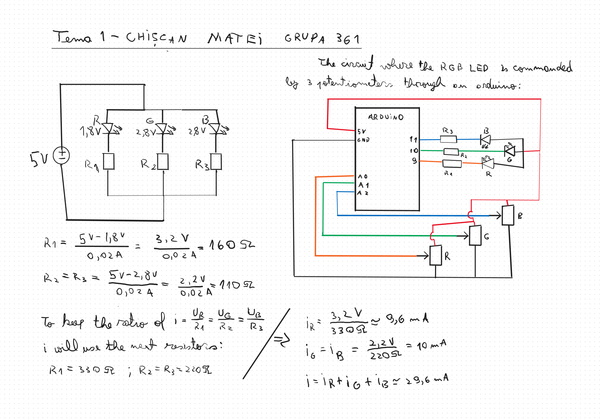
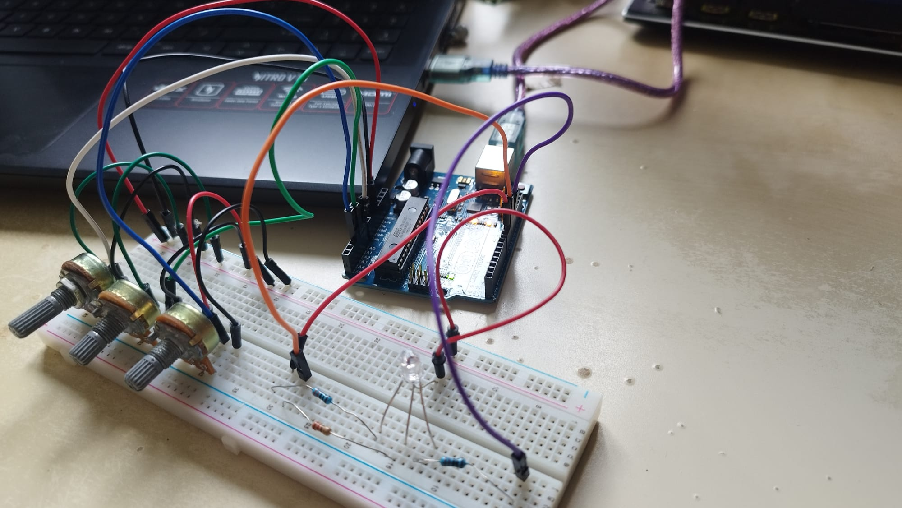
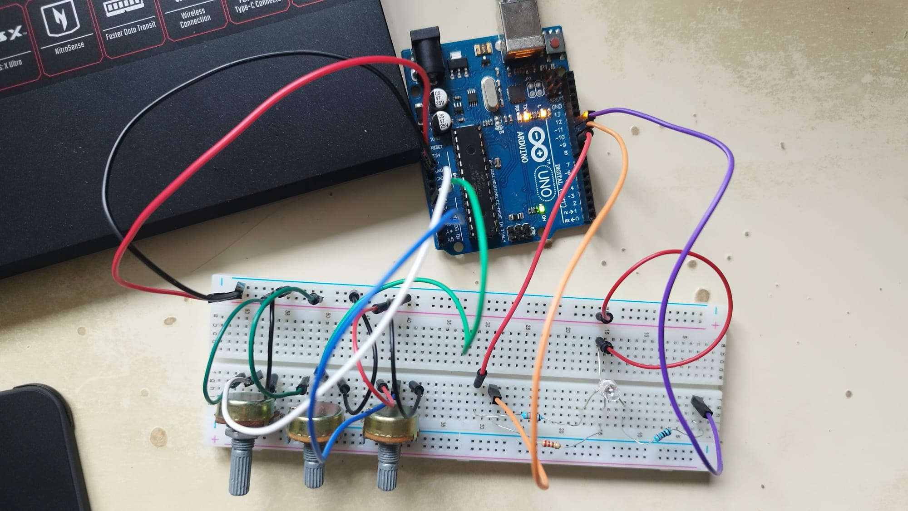
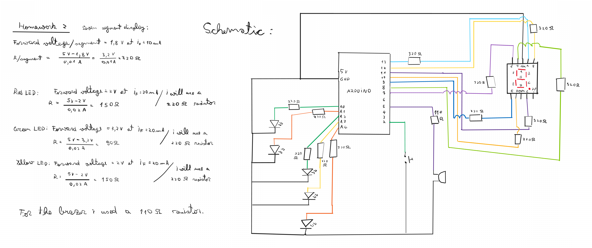
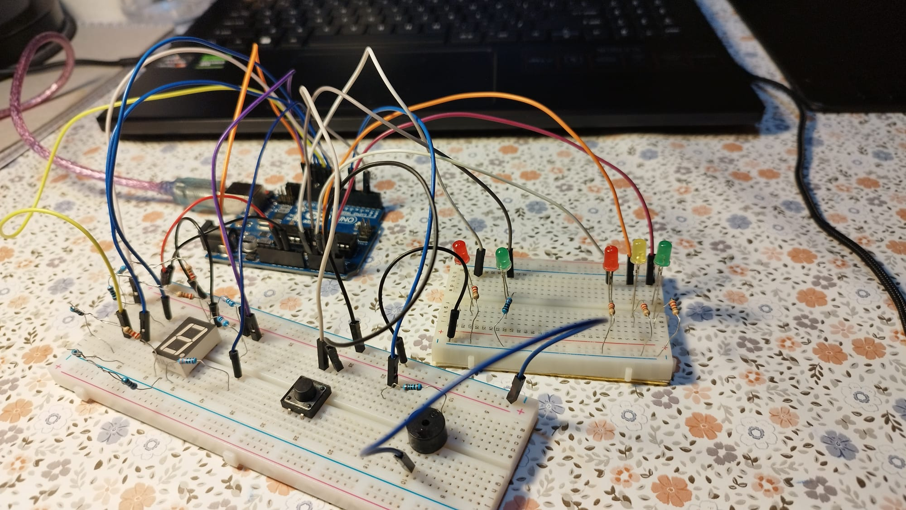
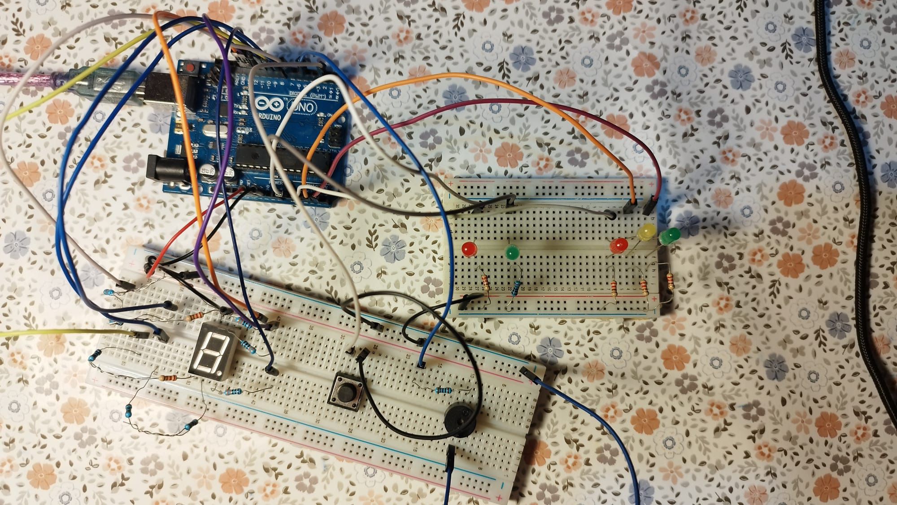

# IntroductionToRobotics
A repository for my Robotics course homeworks

## Homework #1 : RGB LED

### 1. Task:

I used 3 potentiometers to command and RGB LED with an arduino uno as intermidiary, each potentiometer for one of the 3 colours.

### 2. Implementation:

In order to use the the RGB LED(which has a common anode) i had to calculate what resistances to use for each of the LEDs in order to have the same current passing in them all(calculations are shown further down the page). I used 3 analog pins to read the values from the potentiometers and converted them to output values for 3 PWM digital pins. The PWM pins are conected to one resistor each and then to the cathodes of the LEDs. When a PWM pin provides the value 255 (5V) the difference in electric potential energy between the anode and the cathode is 0 so there is no current through the LED. When the value is 0 (0V) then the voltage on the LED is enough to make it turn on (is roughly 2.8V for green and blue and 1.8V for red).

#### Schematics and calculations:

#### Setup:

#### [Video of project implementation](https://www.youtube.com/watch?v=72QZH-2uAGI)

## Homework #2 : Traffic lights system

### 1. Task:

Create a traffic lights system that has 2 traffic lights (3 LEDs for vehicles and 2 LEDs for pedestrians), a 7 segment display (show how many seconds are left until next system state), a buzzer (beeps at different intervals depending on system state) and a button (pedestrians can press the button to make the vehicle light red and the pedestrian light green). The system has 4 states:

1. Red for Pedestrians, Green for vehicles. Awaits button press (can last indefinetely). Upon pressing an 8 second countdown starts and then switches to state 2.

2. Red for Pedestrians, Yellow for vehicles. Lasts 3 seconds then switches to state 3.

3. Green for Pedestrians, Red for vehicles and a buzzer makes a sound at regular intervals. Lasts 8 seconds then switches to state 4.

4. Green that blinks for Pedestrians, Red for vehicles and the buzzer makes a sound more frequently than in the previous state. Lasts 4 seconds then switches back to state 1.

### 2. Implementation:

Implementation was done gradually both in terms of hardware and software:

1. First was the 7 segment display. I looked in the datasheet and calculated what resisors to use (330 ohms) and afterwards i tested whether it was common anode or common cathode (it was common cathode). In terms of software i made a function that looks in a matrix of preset values and sends them to the segment pins in order to show digits.

2. The traffic lights consist of 5 LEDs: 2 green, 2 red and 1 yellow. I used five 220 ohm resistors for them and connected them to 5 analog pins which i used as digital ones. The next step in terms of software was to arrange the states and their sequences and associate durations to them (countdowns are shown on display).

3. I added a button on an interrupt pin (2) and set it up as INPUT_PULLUP so by default it would be on HIGH. I designed the system so the main loop only checks whether there is a countdown to show on the display and what state the system is in. There is a function for each of the 4 states and 2 others for the button functionality. The ISR (interrupt service routine) checks for the possibility of a button press and another confirms it by debouncing. After the confirmation the sequence of states begins. Each state sets up the parameters for the next state(ex: resests the last check of time for the countdown, the duration of the state etc.).

4. I added a buzzer which i connected to a PWM pin (5) and to a 110 ohm resistor. The final software changes i did were making the buzzer "buzz" once every second in state 3 and twice a second in state 4, and making the green pedestrian light blink twice a second in state 4.

#### Schematics and calculations:

#### Setup:

#### [Video of project implementation](https://youtu.be/X22UugSl8GE?si=Flerypy0by5hy_sm)